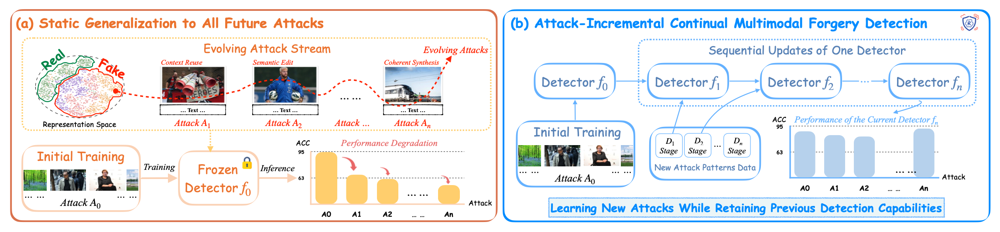
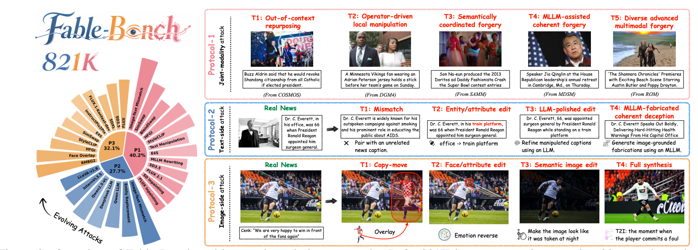
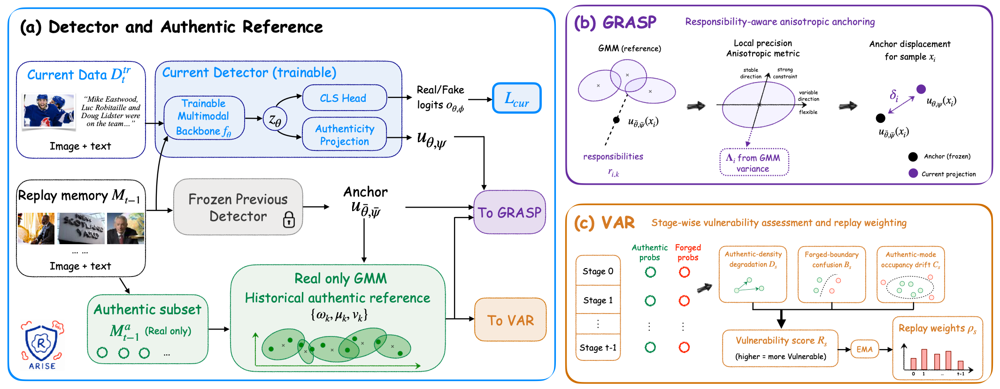
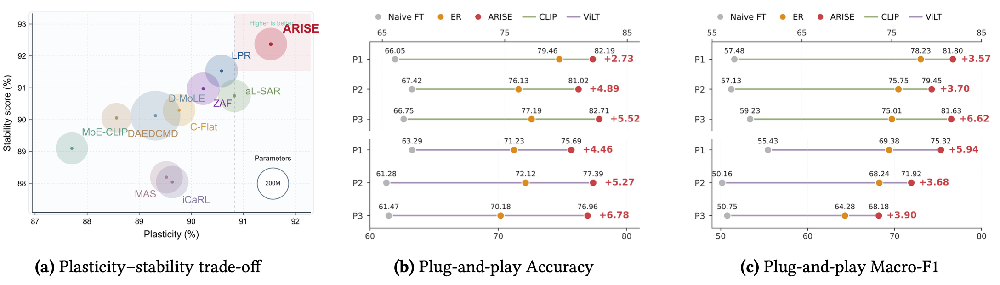

# ARISE: Authentic Reference-Informed Stability Enhancement for Continual Multimodal Forgery Detection


<font size=4><div align='center'>[[📄 Paper]](https://arxiv.org/abs/2610.36509) </div></font>


## 📌 Overview



Existing multimodal forgery detectors are typically trained once on a snapshot of the attack space and then frozen, so their performance degrades substantially as new forgery mechanisms emerge. We instead study **attack-incremental continual multimodal forgery detection**: the binary real/fake interface stays fixed, and a single detector is sequentially updated with new attack data while retaining competence on all attacks seen so far. We propose **ARISE** (*Authentic Reference-Informed Stability Enhancement*), which uses the reusable geometry of authentic content as a stable historical reference to learn new attacks without forgetting old ones.


## 📊 Fable-Bench



**Fable-Bench** (*Forgery Attack Benchmark for Lifelong Evaluation*) organizes successive attack stages rather than being yet another static forgery collection. It contains **821,387 image–text pairs** spanning **30+ manipulation models and attack mechanisms**, with three complementary attack-evolution protocols:


| Protocol               | Evolution Path                                                                                                                                                                  |
| ---------------------- | ------------------------------------------------------------------------------------------------------------------------------------------------------------------------------- |
| **P1: Joint-Modality** | COSMOS → DGM4 → SAMM → MDSM → ROM: from out-of-context repurposing and local manipulation to semantically coordinated, MLLM-assisted, and diverse advanced multimodal forgeries |
| **P2: Text-Side**      | Random mismatch → targeted entity/attribute modification → LM-polished manipulation → image-conditioned coherent deception (with authentic images fixed)                        |
| **P3: Image-Side**     | Copy–move manipulation → face/attribute editing → instruction-guided semantic editing → caption-consistent full-image synthesis (with text semantics controlled)                |


## 🔧 Method

ARISE consists of three components that operate **only during continual updates** and add **no inference-time capacity**:


- **Authentic GMM Reference** — Fits a real-only Gaussian mixture model to projected authentic replay representations, serving as a compact historical reference.
- **GRASP** (*Gaussian-Responsibility-Aware Stability Preservation*) — Derives a sample-adaptive anisotropic metric that strongly constrains historically stable representation directions while retaining plasticity elsewhere.
- **VAR** (*Vulnerability-Aware Replay*) — Estimates stage-wise vulnerability from authentic-density degradation, forged-to-authentic boundary confusion, and authentic-mode occupancy drift, then assigns bounded replay emphasis to fragile stages.

All adaptive signals are obtained from training-time replay statistics; inference uses only the original multimodal backbone and a binary classification head.

## 📈 Results

Across three attack-evolution protocols (P1/P2/P3) and multiple detector architectures, ARISE achieves improved historical retention and final average performance over representative continual-learning baselines (including replay-, regularization-, and architecture-based methods), e.g. **85.37 / 81.22 / 90.47** average accuracy on P1 / P2 / P3 respectively.



## 📖 Citation

If you find this work useful, please consider citing:

```bibtex
@ARTICLE{Zhang2026arise,
  title         = "{ARISE}: Authentic {Reference-Informed} Stability
                   Enhancement for continual multimodal forgery detection",
  author        = "Zhang, Yuchen and Wang, Yaxiong and Wu, Yujiao and Wu,
                   Lianwei and Zhang, Qi and Zhu, Li and Dong, Chaofeng and Wu,
                   Le and Zheng, Zhedong",
  year          =  2026,
  archivePrefix = "arXiv",
  primaryClass  = "cs.CV",
  eprint        = "2610.36509"
}

```

